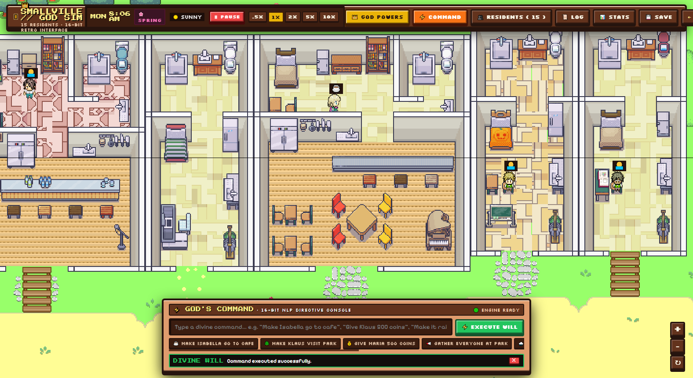
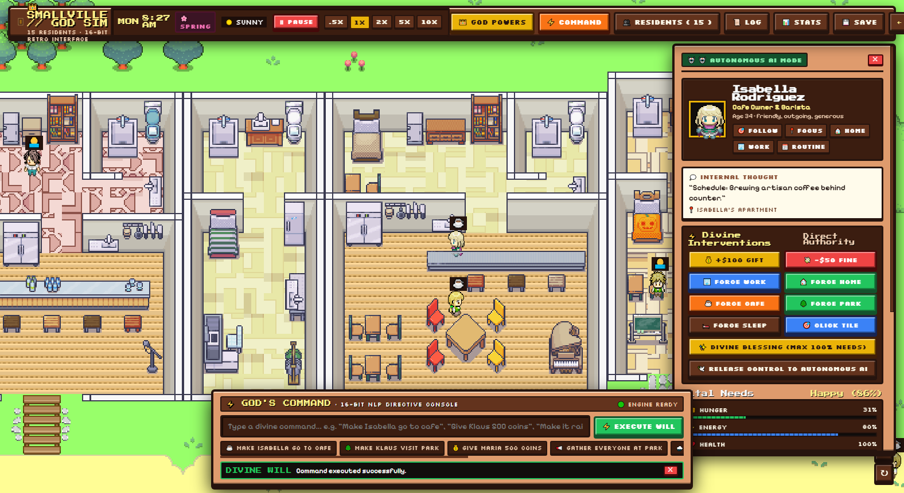
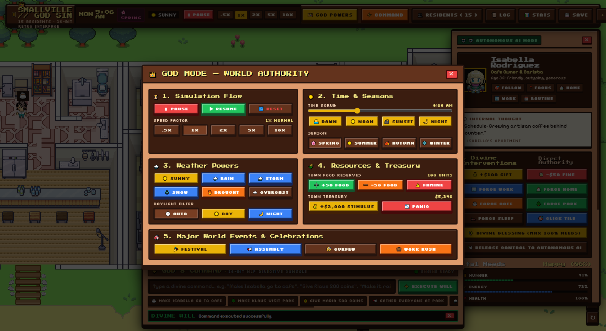
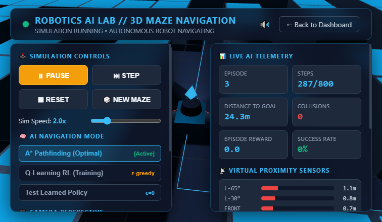
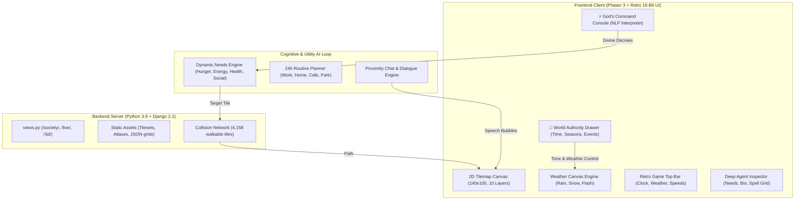

# Smallville: Living 2D AI Society & Retro 16-Bit God Simulator

<p align="center">
  
</p>

An interactive multi-agent artificial life simulation and 16-bit retro God Simulator. Populated by 15 autonomous AI personas living in the pixel-art village of **Smallville**, agents independently perceive their environment, form memories, plan daily agendas, work jobs, socialize in cafes and pubs, and manage their vital survival needs.

As the **World Creator / God**, you hold absolute authority: issue free-text directives through a natural-language **"GOD'S COMMAND"** console, manipulate celestial time, summon rainstorms or blizzards, grant economic stimulus, trigger festivals, or directly intervene in the lives of individual citizens through an authentic 16-bit retro RPG interface.

---

## 🌟 Key Features

### 1. 🎨 16-Bit Retro Pixel-Art User Interface
- **Cohesive Retro Visual Language:** Warm wood/parchment panels (`#df9b6d`), chunky dark borders, and vibrant 16-bit arcade buttons (`Play`, `Option`, `Exit`) inspired by classic SNES and GBA RPGs.
- **Authentic Pixel Typography:** Open-source Google Fonts (`Press Start 2P`, `Silkscreen`, `Pixelify Sans`).
- **Tactile Click Feedback:** Beveled 3D buttons with animated pressed states (`transform: translateY(3px)`).
- **Segmented Need Meters:** Custom segmented pixel-art progress tracks for Hunger, Energy, Health, Happiness, Hygiene, and Social.
- **Retro Dialogue & Thought Boxes:** RPG-style message cards displaying internal thoughts and real-time proximity speech bubbles.
- **Unobstructed Living World:** Clean fullscreen 2D world; resident roster and inspector slide out on-demand only.

<p align="center">
  
  
</p>

### 2. ⚡ Divine Command System ("GOD'S COMMAND")
- **Natural-Language Interpretation Engine:** Type commands in plain English into the bottom-docked retro command window:
  - *"Make Isabella go to cafe"* → Dispatches Isabella to Hobbs Cafe counter.
  - *"Make Klaus visit the park"* → Computes BFS path and sends Klaus to Johnson Park gazebo.
  - *"Give Maria 500 coins"* → Injects $500 directly into Maria's wallet with golden sparkles.
  - *"Make it rain for two hours"* → Summons rainstorm particles and dims ambient light.
  - *"Make everyone gather at Johnson Park"* → Issues a town-wide decree converging all 15 residents on the park.
  - *"Make everyone go to sleep"* → Enacts a town curfew; all residents head home to bed.
  - *"Trigger Town Festival"* → Initiates a town-wide celebration with music and social gatherings.
  - *"Increase happiness of all residents"* → Bestows divine blessing, restoring 100% of all vital needs.
- **Visual Feedback:** Instant confirmation dialogue box displaying `[DIVINE WILL] > Result`.

### 3. 👑 Dedicated God Mode World Authority (`👑 God Powers`)
- **Simulation Flow:** Start, pause, resume, reset, and adjust speeds (`0.5x`, `1x`, `2x`, `5x`, `10x`).
- **Celestial Time Engine:** Real-time 24-hour scrub slider (`00:00` to `23:59`) with preset jumps (*Dawn 06:00, Noon 12:00, Sunset 18:00, Midnight 00:00*).
- **Seasons & Daylight:** Toggle between Spring, Summer, Autumn, and Winter, plus Day/Night override (*Auto, Force Day, Force Night*).
- **Environmental Powers:** Summon *Sunny, Rain, Thunderstorm (with screen flash lightning), Snow, Drought (sepia heat haze), and Overcast*.
- **Resources & Economy:** Adjust Town Food Reserves (+50, -50, Famine) and Town Treasury (+ $2,000 Stimulus, Economic Panic).
- **Major Events:** One-click triggers for Town Festival, Community Gathering, Curfew, and Morning Rush.

### 4. 👥 Autonomous Living 2D AI Society
- **15 Autonomous Residents:** Fully articulated schedules, jobs, and personalities (Isabella Rodriguez, Klaus Mueller, Maria Lopez, Arthur Burton, John Lin, Mei Lin, Eddy Lin, Giorgio Rossi, Tom Moreno, Jane Moreno, Sam Moore, Abigail Chen, Carlos Gomez, Hailey Johnson, Francisco Lopez).
- **Zero-Latency BFS Pathfinding:** Fast navigation across 4,158 validated walkable tiles on the 140x100 Smallville map (`the_ville_jan7.json`).
- **Dynamic Utility AI:** 6 vital needs (Hunger, Energy, Health, Happiness, Hygiene, Social) driving emergent behaviors (e.g., cooking at home when hungry, dining at Hobbs Cafe when wealthy, sleeping when exhausted).
- **Emergent Social Life:** Contextual proximity conversations with comic speech bubbles and relationship affinity tracking.
- **Town Economy:** Salaries paid during work shifts, commercial dining, and crop production by farmer Giorgio Rossi.

### 5. 🤖 3D Autonomous Robot Navigation Lab (`/3d/`)
- A full-featured 3D autonomous robotics simulation built with Three.js.
- Multi-ray LiDAR distance sensors with live dynamic raycasting visualization.
- Autonomous maze navigation powered by reinforcement learning with collision detection and reward tracking.
- Live telemetry HUD displaying episode count, step count, distance to goal, and LiDAR ranges.

<p align="center">
  
</p>

---

## 🏗️ Architecture



---

## 🚀 Quickstart & Installation

### Prerequisites
- **Python 3.9** (Recommended)
- Modern web browser (Chrome, Edge, Firefox)

### 1. Clone the Repository
```bash
git clone https://github.com/[your-username]/generative_agents.git
cd generative_agents
```

### 2. Set Up Virtual Environment & Dependencies
```bash
python -m venv .venv

# Windows
.\.venv\Scripts\activate

# macOS / Linux
source .venv/bin/activate

pip install -r requirements.txt
```

### 3. Launch the Server
```bash
python environment/frontend_server/manage.py runserver 127.0.0.1:8000
```

### 4. Open in Browser
- **2D Pixel-Art God Simulator:** [http://127.0.0.1:8000/society/](http://127.0.0.1:8000/society/) *(or `/live/`)*
- **Central Navigation Portal:** [http://127.0.0.1:8000/](http://127.0.0.1:8000/)
- **3D Autonomous Robot Lab:** [http://127.0.0.1:8000/3d/](http://127.0.0.1:8000/3d/)

### 5. Offline Standalone Mode
You can also run both simulations directly by opening the standalone HTML files in your browser (no server required):
- `living_society_simulation.html` (2D Living Society & God Simulator)
- `robot_3d_simulation.html` (3D Robot Lab)

---

## 🧪 Testing & Verification

Run the automated test suites:

```bash
# 1. Cognitive Architecture & Pathfinding Verification (7 Unit Tests)
python test_simulation_suite.py

# 2. Automated End-to-End Headless Browser Test (Pixel-Art UI & God Commands)
python scripts/test_god_simulator.py
```

All tests execute headless and assert 100% pass rates for agent navigation, speech triggers, command parsing, weather switching, and inspector toggling.

---

## 📜 Attribution & Provenance

This project is an open-source extension of the original research:

> **Generative Agents: Interactive Simulacra of Human Behavior**  
> *Joon Sung Park, Joseph C. O'Brien, Carrie J. Cai, Meredith Ringel Morris, Percy Liang, Michael S. Bernstein*  
> Stanford University & Google Research — UIST 2023  
> Paper: [https://arxiv.org/abs/2304.03442](https://arxiv.org/abs/2304.03442)  
> Original Repository: [https://github.com/joonspk-research/generative_agents](https://github.com/joonspk-research/generative_agents)

For a detailed breakdown of original works, modifications, and third-party resources, refer to [ATTRIBUTION.md](ATTRIBUTION.md), [NOTICE](NOTICE), and [CHANGELOG.md](CHANGELOG.md).

---

## 📄 License

This repository is licensed under the **Apache License 2.0**. See the [LICENSE](LICENSE) file for complete details.  
Third-party component licenses are detailed in [THIRD_PARTY_LICENSES.md](THIRD_PARTY_LICENSES.md).
